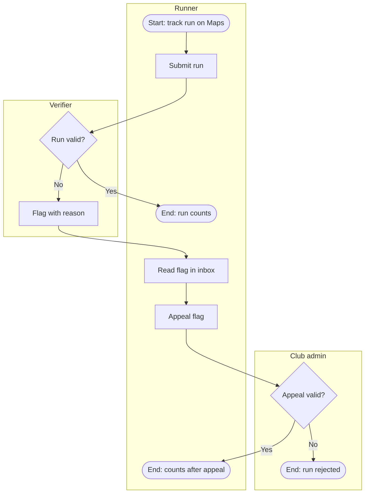

# Workflow: Pace Club

## Users
- **Runner**: tracks runs, submits them, and appeals flags
- **Verifier**: a club member who checks submitted runs
- **Club admin**: decides appeals

## Core process
Track a run → submit → verify or flag → appeal

## Flow (one lane per user)

## Exception path
The Verifier flags a run (for example, an impossible pace). The Runner sees the flag in the inbox and appeals. The Club admin either overturns the flag (the run counts) or upholds it (the run is rejected).

## States of a run
Tracked → Submitted → Verified | Flagged → Under appeal → Overturned (counts) | Upheld (rejected)

## What and why
Pace Club lets runners track a run with location, speed, and distance, then submit it for a club member to verify. The verification step keeps the leaderboard trustworthy. The flag and appeal path keeps the process fair when a run looks wrong, because the runner can respond and an admin makes the final call.
