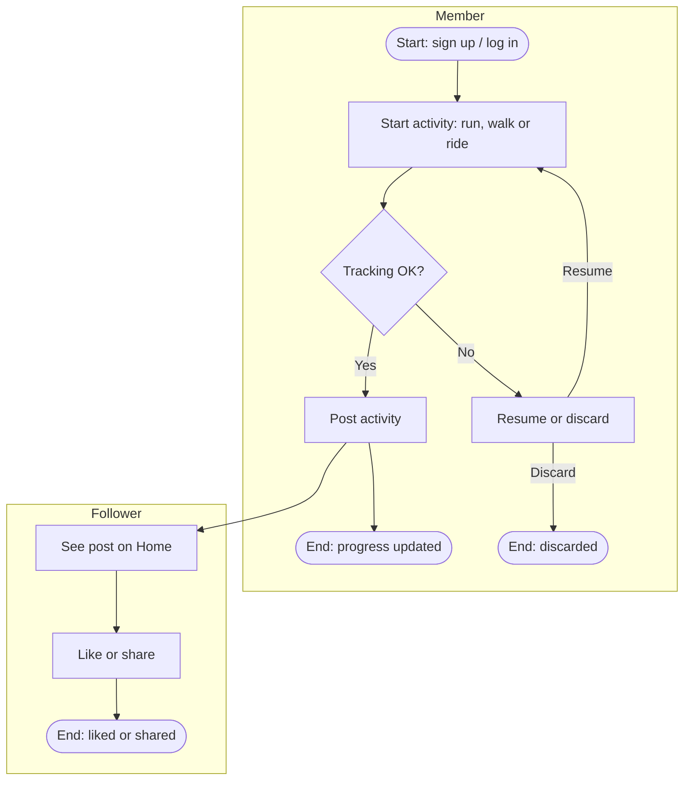

# Workflow: Social Fitness App

## Users
- **Member**: signs up, tracks activities, and posts them
- **Follower**: another member who sees posts and reacts to them

## Core process
Log in → track an activity → post it → followers like or share

## Flow (one lane per user)

## Exception path
Tracking fails during an activity, for example when GPS is lost. The Member either resumes the activity or discards it.

## States of an activity
Tracking → Finished → Posted → Liked or shared
Tracking → Interrupted → Resumed (back to Tracking) | Discarded

## What and why
The app lets members track a run, walk, or ride on the map and post it to their followers. Followers see the post on Home and can like or share it. This keeps members motivated, and their progress is updated on their Account page. The resume-or-discard step handles activities that are interrupted by tracking problems.
